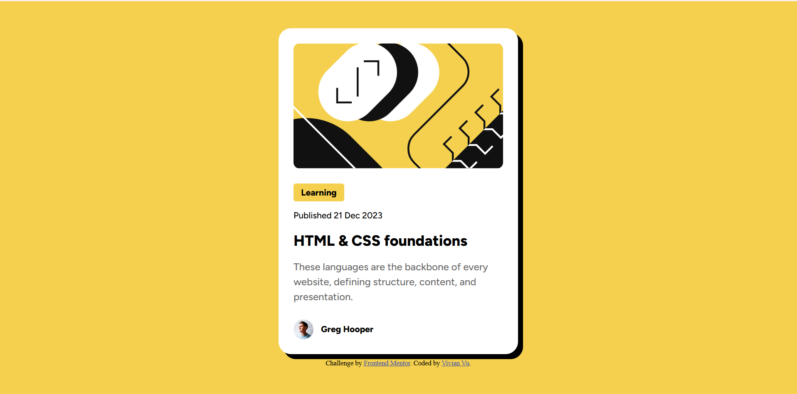

# Frontend Mentor - Blog preview card solution

This is a solution to the [Blog preview card challenge on Frontend Mentor](https://www.frontendmentor.io/challenges/blog-preview-card-ckPaj01IcS). Frontend Mentor challenges help you improve your coding skills by building realistic projects. 

## Table of contents

- [Overview](#overview)
  - [The challenge](#the-challenge)
  - [Screenshot](#screenshot)
  - [Links](#links)
- [My process](#my-process)
  - [Built with](#built-with)
  - [What I learned](#what-i-learned)
  - [Continued development](#continued-development)
  - [AI Collaboration](#ai-collaboration)
- [Author](#author)

**Note: Delete this note and update the table of contents based on what sections you keep.**

## Overview

### The challenge

Users should be able to:

- See hover and focus states for all interactive elements on the page

### Screenshot

### Links

- Solution URL: (https://github.com/viveevu11/blog-preview-card)
- Live Site URL: (https://blog-preview-card-ruddy-omega.vercel.app)

## My process

### Built with

- Semantic HTML5 markup
- CSS custom properties
- Flexbox
- Mobile-first workflow

### What I learned

Through this challenge, I learned that a div tags are essential for grouping similar components together. I also learned that flexboxes can be nested within each other. 

### Continued development

I will continue to use what I learned about flex box direction in my future projects.

### AI Collaboration

I used VS code's built in Copilot to help me debug and brainstorm solutions. It was especially helpful to me when I came accross spacing issues and gave me useful tips I can apply to my next challenge.

## Author

- Frontend Mentor - [@viveevu11](https://www.frontendmentor.io/profile/viveevu11)

